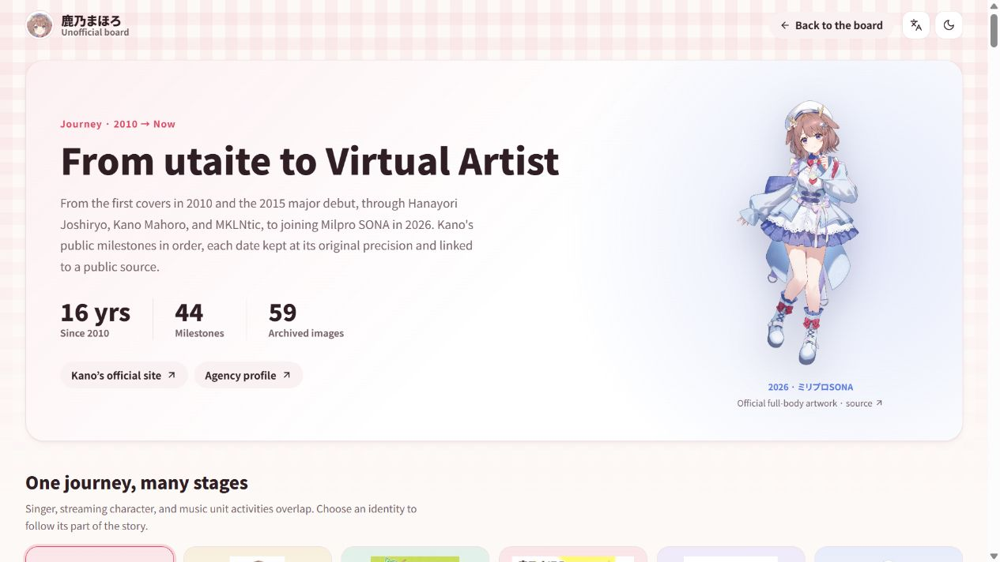
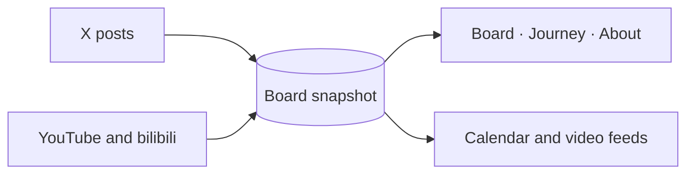

  

<h1 align="center">Kano Navi</h1>

  <b>Kano Mahoro's next stream, schedule, posts, and journey, in one place.</b> 
  An unofficial fan board, published as What’s Kano Up To?

  
  
  
  

Kano Navi gathers the public activity of **Kano Mahoro (鹿乃まほろ)** into one
page: what airs next, the week's schedule, recent posts on X, streams and
works on YouTube, and her journey since 2010. It reads in English, Japanese,
and Simplified Chinese, in light and dark themes, on phones and desktops.

**[Visit kano.yexca.net](https://kano.yexca.net/)**

> [!NOTE]
> Kano Navi is an independent fan project with no official affiliation or
> endorsement. Original announcements always take precedence; see the
> [Disclaimer](#disclaimer).

## Features

<table>
  <tr>
    <td width="50%" valign="top">
      <h3>⏰ What's next</h3>
      A ticket for the next stream or event with its Japan time, your local
      time, and a countdown, switching to <b>On air</b> while a stream is
      live.
    </td>
    <td width="50%" valign="top">
      <h3>📅 Weekly schedule</h3>
      A Monday-first program guide and a month view, with each entry marked
      <b>Auto-detected</b> or <b>Confirmed</b>. <b>Subscribe</b> adds it to
      your calendar app.
    </td>
  </tr>
  <tr>
    <td width="50%" valign="top">
      <h3>💬 Posts on X</h3>
      Recent posts from both accounts, with images, quoted posts, an account
      filter, and a month-by-month archive.
    </td>
    <td width="50%" valign="top">
      <h3>🎬 Streams and works</h3>
      The featured or newest work, upcoming reservations, stream archives, and
      Shorts, with bilibili links for works uploaded there too.
    </td>
  </tr>
  <tr>
    <td width="50%" valign="top">
      <h3>🌱 Journey</h3>
      Milestones from her first covers in 2010 to today, filtered by
      identity, plus a visual archive with sources and credits.
    </td>
    <td width="50%" valign="top">
      <h3>🌏 Your language</h3>
      English, Japanese, and Simplified Chinese, with video titles in your
      language when a translation exists.
    </td>
  </tr>
</table>

Journey page preview

The [User guide](docs/user/index.md) describes every section of the site.

## How It Works

The server collects public posts and videos on a schedule, reads schedule
entries from posts and schedule images, and keeps the result as a local
snapshot. Visitors always read that snapshot, so the board stays fast and keeps
the last known state when a platform is unavailable. See
[How it works](docs/how-it-works.md).

## Run Your Own

Most fans only need the [live site](https://kano.yexca.net/). To run an
instance yourself, see [Docker deployment](docs/operations/docker.md) and
[Configuration](docs/operations/configuration.md). To work on the code, start
with [Local development](docs/development/local-dev.md) and the
[agent guide](AGENTS.md).

## Documentation

- [User guide](docs/user/index.md): the board, schedule, posts, videos, and
  Journey.
- [How it works](docs/how-it-works.md) and [Architecture](docs/architecture/index.md):
  data flow and system boundaries.
- [Operations](docs/operations/index.md): running an instance.
- [Development](docs/development/index.md): local setup, testing, and releases.
- [Security](SECURITY.md), including how to report a vulnerability.
- [Documentation index](docs/README.md): every public document.

## Disclaimer

- Kano Navi is an independent fan project. It is not affiliated with or
  endorsed by Kano Mahoro, her agency, X, YouTube, or bilibili.
- Every post, video, and event links to its original public page, which is
  always authoritative.
- Artwork, artist names, and other third-party content keep their original
  rights; the code license does not grant rights to them. Image sources and
  credits are recorded in the
  [history archive](docs/development/history-archive.md).

## License

Created by [yexca](https://github.com/yexca). Kano Navi is free software
licensed under the [GNU Affero General Public License v3.0](LICENSE). The
About page lists the development credits and technology stack.
