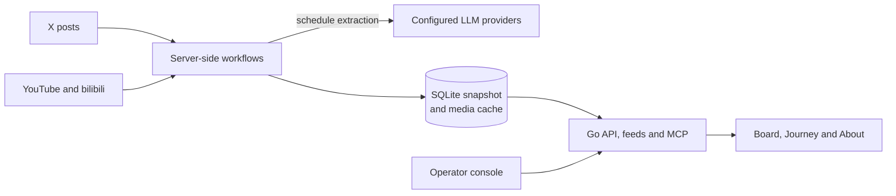

# How It Works

Kano Navi is an unofficial status board for Kano Mahoro fans, published as
What’s Kano Up To? (English), 鹿乃ちゃん何してるか (Japanese), and 鹿乃在做什么
(Simplified Chinese). Kano Navi is the project, repository, and release name.
What visitors see is described in the [User guide](user/index.md); this page
explains how the board gets there and what it deliberately does not do.

## Goals

- Aggregate public updates into a stable, scannable page.
- Store external data as a local SQLite snapshot instead of fetching on every
  page view.
- Keep changing platform media in an ignored, traceable cache instead of the
  Git repository or a browser-side CDN request.
- Distinguish completed, upcoming, tentative, and temporarily unavailable
  information.
- Keep every resource traceable to its original public page without exposing
  credentials or the maintainer's environment.

## Non-goals

- Do not become a full X/YouTube client, comment system, or account-login
  surface.
- Do not promise push-level real-time updates; freshness depends on how often
  the source timers or manual synchronization run.
- Do not bypass login walls, CAPTCHAs, access restrictions, or platform API
  permissions.
- Do not present fan-maintained material as an official announcement; the
  original platform page is always authoritative.

## Data Flow

1. Source timers, an operator's Run now, or an authorized MCP client start a
   workflow. Workflows read public X and YouTube pages (and bilibili copies),
   download their images into the media cache, and write a SQLite snapshot.
   A failed source keeps the previous snapshot and records its outcome.
2. Schedule extraction reads candidate posts and schedule images and asks the
   configured LLM providers for structured events. Uncertain results create no
   events; manual edits and confirmations lock an event against automatic
   replacement.
3. Page loads, the reload button, and revision checks only read the stored
   snapshot through the local API. They never contact X, YouTube, or a model
   provider.
4. Each completed workflow or operator change advances a small revision
   number. The server watches it and pushes each change to open pages over a
   stream, and a page then reloads the snapshot; when the stream is
   unavailable, pages ask for the revision every 30 seconds instead. A page
   also revalidates its snapshot once a minute, because times such as a
   stream's start pass without a stored change.

The profile, milestones, resource links, and the Journey images ship with the
code. Source snapshots and LLM providers start empty on a fresh installation.
See [Core boundaries](architecture/core-boundaries.md) for the full contract.

## Operator Console and MCP

An unlinked, password-protected `/admin` console is organized around operator
tasks: an overview of what waits for a decision and the active run, a review
queue for schedule images, suspected cancellations, and failed extractions,
schedule curation with durable locks, posts, videos and the featured video,
profile images, the run history and one-off step runs, sources with their
timers, fetch windows and YouTube push, schedule detection settings, and the
LLM provider catalog with one ordered model queue. See the
[Admin API](architecture/admin-api.md).

`/mcp` offers sanitized read tools without a key and narrowly scoped
automation behind a separate bearer token; confirmation and other human-only
actions stay in `/admin`. See [Public API](architecture/public-api.md).

## Known Limits

- X profile structure, the public status endpoint, and YouTube page structure
  may change. Synchronization records warnings and retains the old snapshot; a
  failed fetch must not be interpreted as no update.
- Activity times are displayed in the Japan time zone. Low-confidence or
  important entries can be confirmed and locked manually.
- The deployment is a single SQLite instance with one password-protected
  maintainer surface, in-memory sessions, and no multi-user permission model.
  MCP control uses a separate environment token and does not inherit the admin
  session.
- Cached media files are kept deliberately rather than garbage-collected;
  unready media is shown as unavailable.

## Maintainer Decision Rule

When a new request conflicts with “easy to understand at a glance,” “traceable
data,” or “old data survives a failure,” preserve those three properties
first. Before adding a source, describe its fetch boundary, cached fields,
failure behavior, and public links.

## Related Docs

- [Architecture](architecture/index.md)
- [Design](development/design.md)
- [Local development](development/local-dev.md)
- [Documentation index](README.md)
